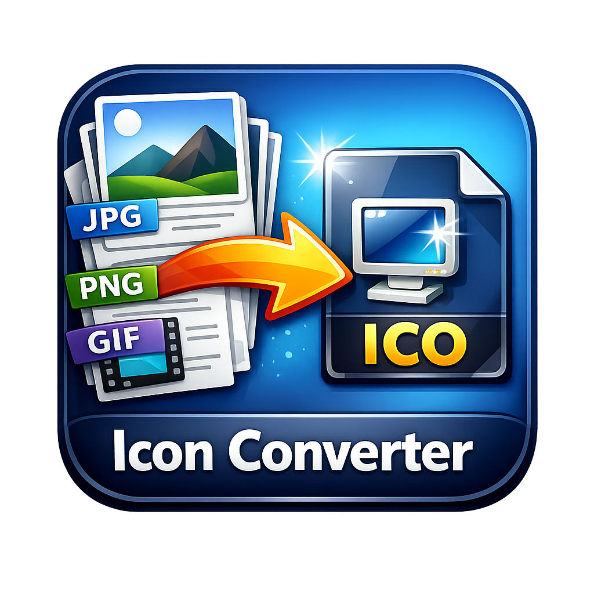

<div align="center">



# ICO Converter

**A polished, native desktop utility for turning any image into a multi-resolution Windows `.ico` — built with Rust & egui.**


</div>

---

## ✨ What's inside

A complete UI redesign built around a small, consistent design system:

- 🎨 **Professional light & dark themes** — one palette of design tokens, switched instantly from the header.
- 🔤 **Bundled Inter typeface** (regular / semibold / bold) — identical typography on every machine, no font installation needed.
- 🧩 **Card-based, numbered workflow** — Source image → Icon sizes → Export, with a sticky action bar.
- 🖼️ **Live preview** on a transparency checkerboard, plus a ruler showing the icon at 16 / 24 / 32 / 48 / 64 px.
- 📏 **Aspect-ratio control** — *Fill & crop* (centre-crop) or *Fit & pad* (transparent letterbox), so non-square images never get squashed.
- 🖱️ **Drag & drop anywhere** in the window, browse dialog, `Replace` / `Remove` actions and in-memory drops.
- 🎯 **Crisp vector icons** drawn at runtime (no emoji, no missing-glyph boxes).
- 🔔 **Inline success / error notifications** with dismiss, and a helpful About dialog.
- 🪟 **Native window icon** on every platform (loaded from `icon.ico`), plus a stable app id.
- ♿ Scrollable content that stays usable down to a 470 × 660 window.

### Functionality

| Feature | Detail |
|---------|--------|
| Input | PNG · JPG · JPEG · BMP · GIF · WEBP · TIFF · TIF |
| Output | Single `.ico` containing every selected resolution |
| Sizes | 16, 24, 32, 48, 64, 128, 256 px (toggle independently) |
| Resampling | Lanczos3, high quality |
| Transparency | Alpha channel preserved end-to-end |
| Shortcuts | `Ctrl+O` browse · `Ctrl+Enter` export · `Esc` close dialog |
| Default filename | Derived from the source file (`photo.png` → `photo.ico`) |

---

## 🚀 Getting started

### Prerequisites

- [Rust](https://rustup.rs/) 1.75+ (stable) with Cargo
- Linux: `libgtk-3-dev` and `libxkbcommon-x11-0` (for native file dialogs / winit)
- Windows: nothing extra — `build.rs` embeds `icon.ico` into the executable

```bash
cargo run                 # debug
cargo build --release     # optimised binary in target/release/
```

### Usage

1. **Drop an image** onto the window, click the dashed area, or press `Ctrl+O`.
2. **Pick resolutions** (all seven are selected by default) and choose how non-square images should be fitted.
3. Click **Convert & Save ICO**, choose a destination, done. ✅

---

## 🖥️ Design preview

Because this is a native app, it cannot run inside a browser sandbox. An interactive HTML mirror of the new interface lives at
[`docs/design-preview.html`](docs/design-preview.html) — open it locally, or serve the repository root:

```bash
python3 -m http.server 8080
# http://localhost:8080/docs/design-preview.html
```

The preview supports theme switching, image drop, size chips, fit modes, the About dialog and notifications. It uses the exact
same colour tokens and bundled Inter fonts as the egui implementation.

---

## 📁 Project structure

```
├── src/
│   ├── main.rs            # Window setup + native app icon
│   ├── app.rs             # State, file handling, shortcuts, panel layout
│   ├── theme.rs           # Design tokens, Inter fonts, egui visuals, card frame
│   ├── icons.rs           # Vector icon primitives + dashed rounded border
│   ├── converter.rs       # Square framing, Lanczos3 resize, ICO encoding
│   ├── utils.rs           # Validation, labels, human-readable sizes
│   └── widgets/
│       ├── header.rs      # App bar (brand, theme toggle, About)
│       ├── section.rs     # Numbered section heading
│       ├── drop_zone.rs   # Source card, preview, file details, size ruler
│       ├── sizes.rs       # Resolution chips + aspect-ratio segmented control
│       ├── footer.rs      # Summary + primary export action
│       ├── status.rs      # Inline notification
│       └── about.rs       # About modal
├── assets/fonts/          # Inter (SIL Open Font License 1.1, see OFL-LICENSE.txt)
├── docs/design-preview.html
├── icon.ico               # Application icon
└── build.rs               # Windows icon resource
```

---

## 🛠️ Tech stack

- **[eframe / egui 0.28](https://github.com/emilk/egui)** — immediate-mode native GUI
- **[image 0.25](https://github.com/image-rs/image)** — decoding, cropping, resizing
- **[ico 0.3](https://github.com/image-rs/ico)** — ICO container encoding
- **[rfd 0.14](https://github.com/PolyMeilex/rfd)** — native file dialogs
- **[winres](https://github.com/mxre/winres)** — Windows executable icon
- **Inter** by Rasmus Andersson — SIL Open Font License 1.1

The release profile stays tuned for a small binary (`opt-level = "z"`, LTO, strip, `panic = "abort"`).

---

## 👤 Developer

| Field | Details |
|-------|---------|
| **Username** | Sajedur0 |
| **GitHub** | [sajedur0](https://github.com/sajedur0) |
| **Website** | [sajedur0.github.io](https://sajedur0.github.io) |

## 📄 License

[MIT](LICENSE) © 2026 · Bundled Inter font under [SIL OFL 1.1](assets/fonts/OFL-LICENSE.txt).

---

<div align="center">

**Made with ❤️ in Rust**

</div>
